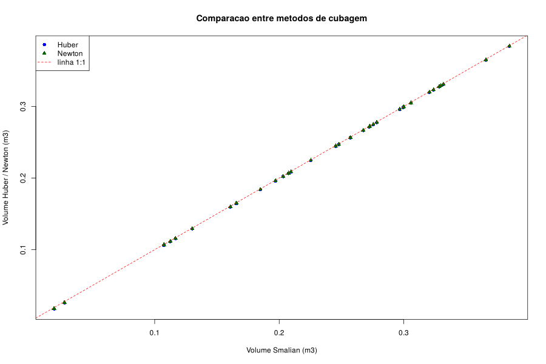
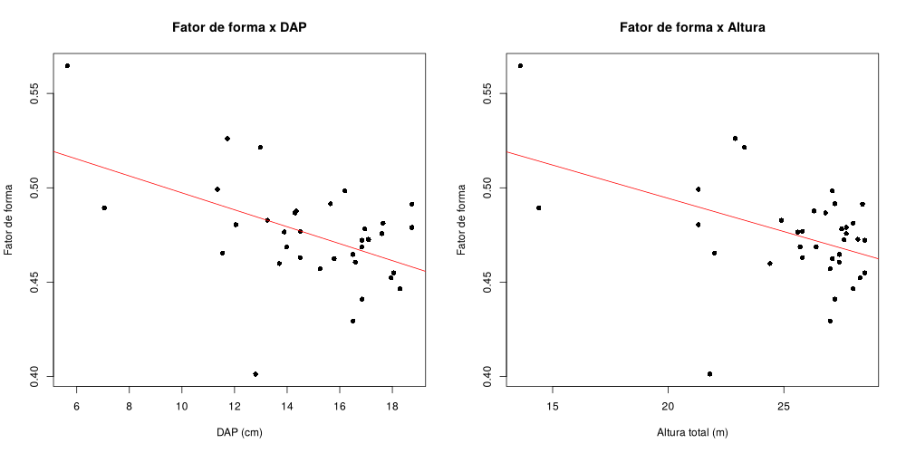

<div align="center">

# 🌲 Desafio 03 — Volume e forma

**Cubagem rigorosa, fator de forma e quociente de forma**

   

*Disciplina Mensuração Florestal · Programa de Pós-Graduação em Ciências Florestais · ICA/UFMG*

</div>

## 📋 Objetivo

Calcular o volume das árvores cubadas pelos métodos de Smalian, Huber e Newton, determinar o fator de forma e o quociente de forma de Girard e analisar como a diferença entre os métodos varia com o diâmetro.

## 🗂️ Dados

Cubagem rigorosa de 36 árvores do talhão 8 (1.125 seções medidas).

Arquivo: [`dados/cubagem.xlsx`](dados/cubagem.xlsx).

## 🔧 Métodos

- **Smalian, Huber e Newton**, com o diâmetro no meio da seção obtido por interpolação linear entre os diâmetros extremos.
- Trecho entre o solo e a primeira medição (0,10 m) desconsiderado.
- **Fator de forma** = volume real (Smalian) ÷ volume do cilindro (g<sub>DAP</sub> × HT).
- **Quociente de forma de Girard** = diâmetro a 5,2 m ÷ DAP, com o diâmetro a 5,2 m interpolado.
- Diferenças percentuais entre métodos agrupadas por classe de DAP.

## 📈 Principais resultados

| Indicador | Média | Amplitude |
|---|:-:|:-:|
| Volume Smalian (m³) | 0,229 | 0,019 – 0,385 |
| Fator de forma | 0,475 | 0,401 – 0,565 |
| Quociente de forma | 0,884 | 0,766 – 0,923 |

| Classe de DAP (cm) | Árvores | Diferença média Smalian–Huber (%) |
|:-:|:-:|:-:|
| 4–6 | 1 | 11,03 |
| 6–8 | 1 | 6,70 |
| 10–12 | 3 | 1,07 |
| 12–14 | 7 | 0,81 |
| 14–16 | 7 | 0,49 |
| 16–18 | 13 | 0,39 |
| 18–20 | 4 | 0,34 |

- Os três métodos convergem nas árvores maiores; a diferença cresce nas árvores finas.
- Correlação entre DAP e diferença Smalian–Huber: r = −0,77.

<p align="center">
  <br>
  <sub><b>Volume por Huber e Newton contra Smalian (linha 1:1)</b></sub>
</p>

<p align="center">
  <br>
  <sub><b>Fator de forma em função do DAP e da altura</b></sub>
</p>

## 📁 Estrutura do repositório

```text
desafio-03-volume-e-forma/
├── dados/
│   └── cubagem.xlsx                        # 36 árvores cubadas
├── scripts/
│   ├── 01_cubagem_forma.R                  # Smalian, Huber, Newton, fator e quociente de forma
│   └── 02_diferencas_por_classe_dap.R      # diferença entre métodos por classe de DAP
├── resultados/
│   ├── tabelas/                            # resultados por árvore e por classe
│   └── figuras/
└── docs/
    ├── enunciado.pdf
    ├── relatorio_curto.docx
    ├── respostas.pdf
    ├── item6_diferencas_por_classe_dap.md
    └── metodologia_detalhada.md
```

## ▶️ Como executar

A partir da raiz do repositório:

```r
install.packages(c("readxl", "writexl", "dplyr"))
```

```bash
Rscript scripts/01_cubagem_forma.R
Rscript scripts/02_diferencas_por_classe_dap.R
```

## 📄 Documentos

- 📝 [Enunciado](docs/enunciado.pdf)
- 📊 [Relatório curto](docs/relatorio_curto.docx)
- ✅ [Respostas](docs/respostas.pdf)
- 📐 [Diferenças por classe de DAP](docs/item6_diferencas_por_classe_dap.md)
- 🔍 [Metodologia detalhada](docs/metodologia_detalhada.md)

## 🧭 Série de desafios

| # | Desafio | |
|:-:|---|:-:|
| 01 | [Diâmetro](https://github.com/danieldias936-cyber/desafio-01-diametro) | |
| 02 | [Altura e relação hipsométrica](https://github.com/danieldias936-cyber/desafio-02-altura) | |
| **03** | **Volume e forma** | 📍 você está aqui |
| 04 | [Volume reduzido e equações de volume](https://github.com/danieldias936-cyber/desafio-04-volume-reduzido-e-tabela) | |
| 05 | [Taper e sortimento](https://github.com/danieldias936-cyber/desafio-05-taper-e-sortimento) | |
| 06 | [Amostragem de Bitterlich](https://github.com/danieldias936-cyber/desafio-06-bitterlich) | |
| 07 | Classificação de sítios florestais | ⏳ |
| 08 | [Validação do índice de sítio](https://github.com/danieldias936-cyber/desafio-08-validacao-sitio) | |
| 09 | [Crescimento e produção (Clutter)](https://github.com/danieldias936-cyber/desafio-09-modelo-clutter) | |

## 👤 Autor

**Daniel Dias** · [@danieldias936-cyber](https://github.com/danieldias936-cyber)  
Mestrado em Ciências Florestais — ICA/UFMG, Montes Claros (MG)
